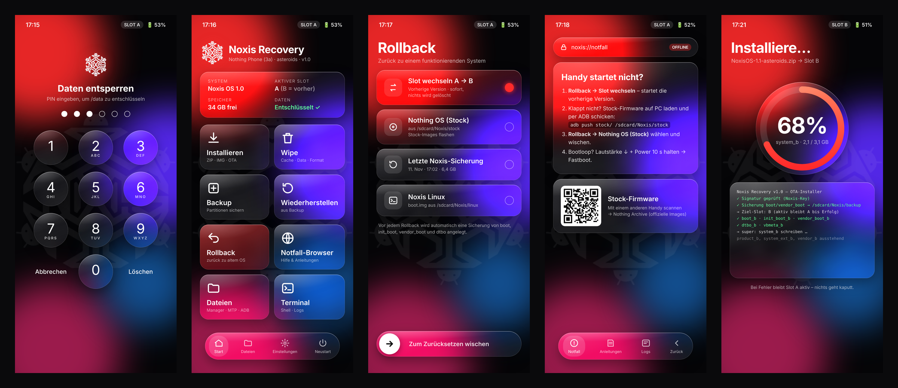
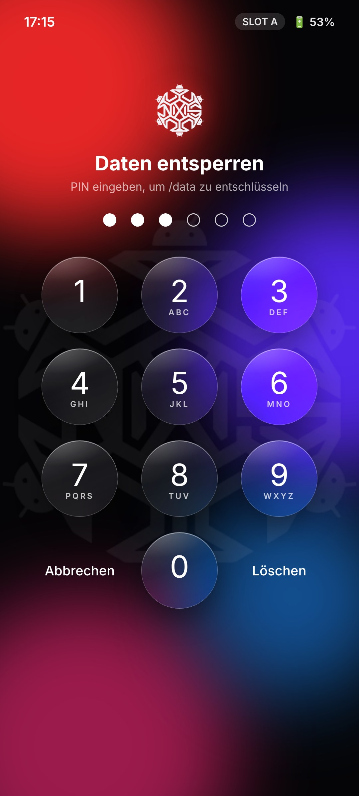
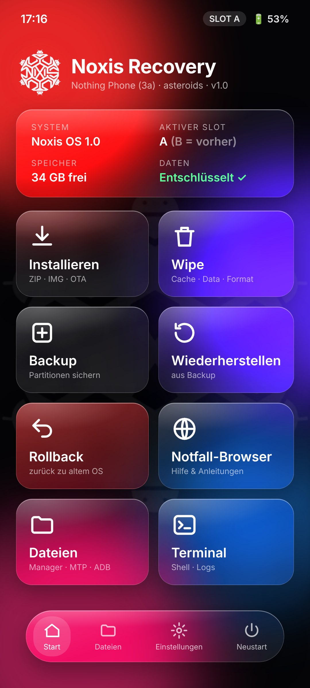
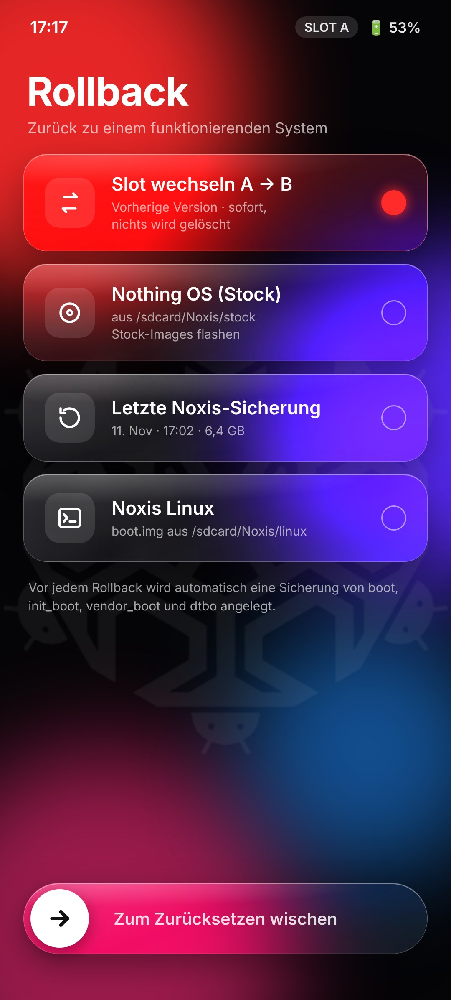
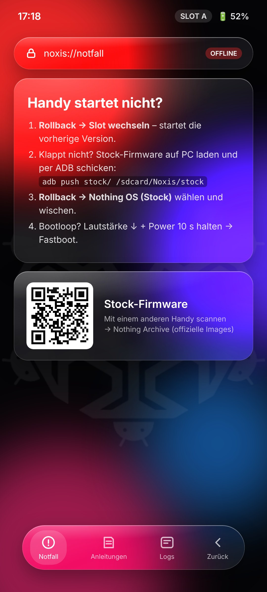
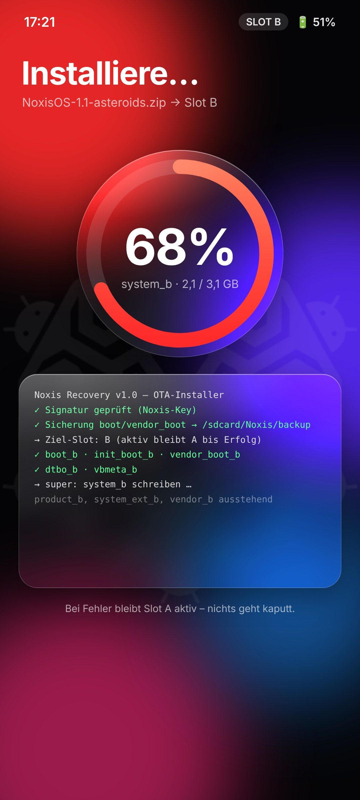

<p align="center"></p>

<h1 align="center">Noxis Recovery</h1>
<p align="center">A custom recovery for the <b>Nothing Phone (3a)</b> (<code>asteroids</code>, SM7635), with a liquid-glass design.<br>
Part of <a href="https://github.com/Real3rr0r303YT/NoxisOS">Noxis OS</a> and <a href="https://github.com/Real3rr0r303YT/NoxisLinux">Noxis Linux</a>.</p>

<p align="center"></p>

> **Status: design phase.** The screens above are design mockups. There is no `recovery.img` release yet.
> Never flash an untested recovery. The first builds will be tested with `fastboot boot` only, which does not change anything on the phone.

## Features (planned)

| | |
|---|---|
| **Liquid-glass UI** | Frosted glass panels on a blurred wallpaper, rounded tiles and a floating tab bar, built on the TWRP/OrangeFox engine |
| **Rollback** | Go back to a working system: switch the A/B slot, flash stock Nothing OS from `/sdcard/Noxis/stock`, restore the last Noxis backup or boot Noxis Linux |
| **Auto backup** | `boot`, `init_boot`, `vendor_boot` and `dtbo` are backed up before every flash or rollback |
| **Safe OTA install** | The inactive slot is flashed; the active slot stays bootable until the install succeeds |
| **Emergency browser** | An offline help browser (`noxis://notfall`) with recovery guides, logs and QR codes for downloading stock firmware on another device |
| **Decryption** | Unlock `/data` with your PIN |
| **Tools** | File manager, MTP, ADB sideload, terminal |
| **Languages** | Deutsch, English, Türkçe, Français, Български, Русский, Українська |

The emergency browser is **offline**: the 3a's Wi-Fi does not work in recovery mode, so it shows built-in pages and QR codes instead of loading websites.

## Screens

| Unlock | Home | Rollback | Emergency | Install |
|---|---|---|---|---|
|  |  |  |  |  |

The mockups are made from [`design/mock.html`](design/mock.html). Open `mock.html#home`, `#rollback`, `#browser`, `#unlock` or `#install` in a browser.

## Testing (once a build exists)

```bash
adb reboot bootloader
fastboot boot noxis-recovery.img   # temporary, nothing is flashed
```

Do not relock the bootloader with a custom recovery or ROM installed.

## Support

If you like the project: ☕ **[Buy me a coffee](https://buymeacoffee.com/3rr0r303YT)**

## License

[GNU General Public License v3.0](LICENSE). Noxis Recovery is based on TWRP and OrangeFox (both GPL).
