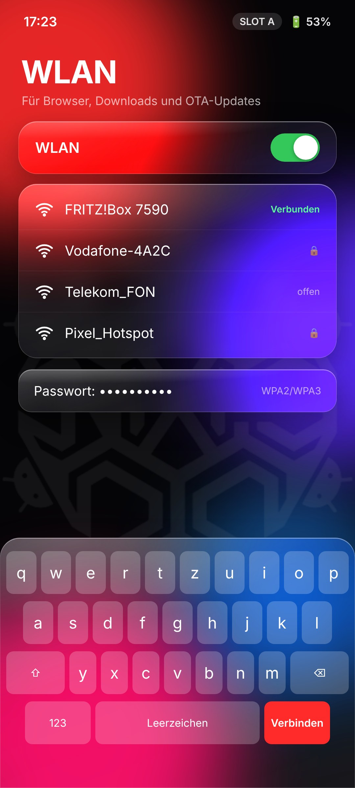

<p align="center"></p>

<h1 align="center">Noxis Recovery</h1>
<p align="center">A custom recovery for the <b>Nothing Phone (3a)</b> (<code>asteroids</code>, SM7635), with a liquid-glass design.<br>
Part of <a href="https://github.com/Real3rr0r303YT/NoxisOS">Noxis OS</a> and <a href="https://github.com/Real3rr0r303YT/NoxisLinux">Noxis Linux</a>.</p>

<p align="center"><b>Made by <a href="https://www.tiktok.com/@3rr0r303yt">3rr0r303YT on TikTok</a></b><br>
<a href="LICENSE"></a>
<a href="https://buymeacoffee.com/3rr0r303YT"></a></p>

<p align="center"></p>

> **Status: design phase.** The screens above are design mockups. There is no `recovery.img` release yet.
> Never flash an untested recovery. The first builds will be tested with `fastboot boot` only, which does not change anything on the phone.

## Features (planned)

| | |
|---|---|
| **Liquid-glass UI** | Frosted glass panels on a blurred wallpaper, rounded tiles and a floating tab bar, built on the TWRP/OrangeFox engine |
| **Rollback** | Go back to a working system: switch the A/B slot, flash stock Nothing OS from `/sdcard/Noxis/stock`, restore the last Noxis backup or boot Noxis Linux |
| **Auto backup** | `boot`, `init_boot`, `vendor_boot` and `dtbo` are backed up before every flash or rollback |
| **Safe OTA install** | The inactive slot is flashed; the active slot stays bootable until the install succeeds |
| **Wi-Fi** | Connect to WPA2/WPA3 networks in recovery (qca6750 driver, firmware loaded from the phone's own partitions) |
| **Browser** | Lightweight web browser in recovery: open GitHub releases, download ROMs and firmware to `/sdcard/Noxis/download` with SHA-256 check |
| **Emergency pages** | Built-in offline help (`noxis://notfall`) with guides, logs and QR codes, which also work without Wi-Fi |
| **Decryption** | Unlock `/data` with your PIN |
| **Tools** | File manager, MTP, ADB sideload, terminal |
| **Languages** | Deutsch, English, Türkçe, Français, Български, Русский, Українська |

Wi-Fi in recovery is the hardest part: the Qualcomm Wi-Fi chip needs its kernel modules, firmware and helper daemons, which normally only run in Android. It will be marked **experimental** until it works on a real device. The browser renders normal web pages; heavy JavaScript sites (YouTube, web apps) are not the goal.

## Screens

| Unlock | Home | Wi-Fi | Browser | Rollback | Install |
|---|---|---|---|---|---|
|  |  |  |  |  |  |

The mockups are made from [`design/mock.html`](design/mock.html). Open `mock.html#home`, `#wifi`, `#browser`, `#rollback`, `#unlock` or `#install` in a browser.

## Testing (once a build exists)

```bash
adb reboot bootloader
fastboot boot noxis-recovery.img   # temporary, nothing is flashed
```

Do not relock the bootloader with a custom recovery or ROM installed.

## Support

If you like the project: ☕ **[Buy me a coffee](https://buymeacoffee.com/3rr0r303YT)**

## Credits

Made by **[3rr0r303YT on TikTok](https://www.tiktok.com/@3rr0r303yt)** · GitHub [Real3rr0r303YT](https://github.com/Real3rr0r303YT)

## License

[GNU General Public License v3.0](LICENSE). Noxis Recovery is based on TWRP and OrangeFox (both GPL).
